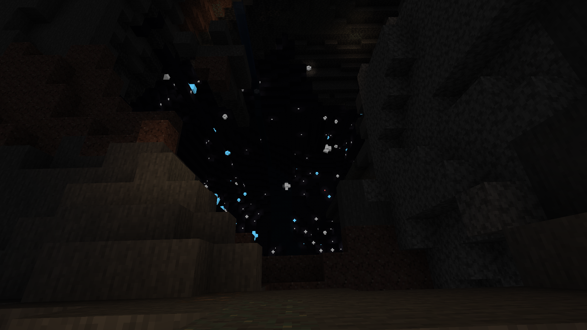
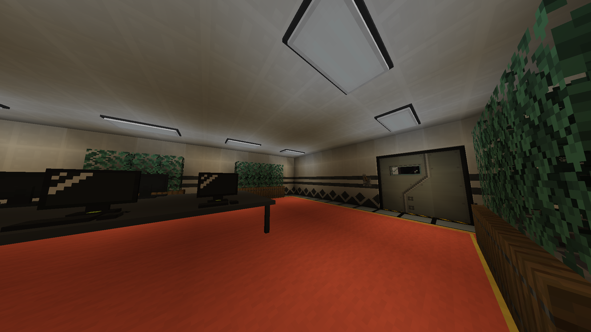

# The nothing update third edition - 1.1.9

### Additions:
- Domain Expansion: Idle Death Gamble
   > Parry 5 times to charge up your cursed technique, then expand your domain. A Snep will try their luck on the scenarios (the ticket gate, the metro station bathroom and the exit to the surface), and every scenario that goes by raises your luck multiplier for the next one, up to 10x. Hitting the jackpot grants the "Cursed Technique: Instant Jackpot": infinite cursed energy (effectively immortality) for 4 minutes and 11 seconds
   > Comes with its own dimension, arena, sounds, animations and screen shake

- Latex Carneline, Latex Panther and Latex Kaiju transfur variants
   > The panther has glowing eyes, avoids sunlight and hides in the shadows during the day. The kaiju can pick up and wear equipment like the other latexes
   > Obtainable with their syringes, or by touching the matching crystals in the Blue Cave (see below)

- Four new Cone Kat flavors: Mint, Choco, Strawberry and Neapolitan
   > With matching ice creams. Eating 5 ice creams of the same flavor in a row transfurs you into that flavor's Cone Kat. The pink one is safe and never transfurs you
   > The old ice cream is now "Vanilla Ice Cream"

- The **Blue Cave**, a new biome that generates in overworld caves
   > 
   > Blue stone, crystal pillars and strange crystals that grow over time (bone meal works on them too). Their color depends on the light they sit in: bright light makes blue crystals, medium makes red and darkness makes white
   > Touching them is infectious: the blue ones infect you with the kaiju, the red ones with the carneline and the white ones with the panther
   > Also generates couches with loot, and has a matching blue cave room in the **Biological studies facility**
   > 

- Jam ability for the Jammer Headphones
   > While jamming you're frozen in place (you can still look around and open menus) and regenerate 1 heart every 2 seconds. Removing the headphones or taking damage stops the jam, and damage leaves you slowed

- The **Forbidden Library**, a new room for the Changed facility
   > 
   > Every chiseled bookshelf is filled on generation: 70% normal books, 29% enchanted books (weighted by how commonly players use each enchantment) and 1% written books pulled from this mod and the Changed Addon

- Prepare ability
   > Reveals every entity within your render distance with a yellow outline for 10 seconds

- Strange Crystal Shard, and the ability to generate them
   > Drops from strange crystals, and the ability condenses 6 hunger into one

- New death screen
   > With flavor text depending on how (and as what) you died, and a new choice: respawn as a human, or respawn as the form you had. Toggleable with the useCustomDeathScreen config

- /changedextras commands
   > choice, vip and debug, plus an admin-only reset and the /cedebug alias. Every command in this mod now lives under one root node

- New animations for Katto and the Latex Jammer

### Changes

- Removed the Furred Latex Tiger Shark and both Fluffed Up Latex Snow Leopards
- Reworked the Parry: strict timings (0.5s startup, 2.25s active window, 5s cooldown, plus an extra lock when you fail), parry doors, animations, and screen shake with a sound cue when your domain is ready
- The Latex Panther can't see or target players standing in sunlight, and playing as one during the day applies a sun glare overlay ("The light blinds you.")
- Smart latex AI was nerfed across the board (it now stays a step behind a sprinting player) and is now disabled by default, re-enable it with the changedextras:smart_latex_ai gamerule
- Gamerules are namespaced now (changedextras:latex_equipment_enabled, changedextras:give_guidebook, etc.)
- Experiment 012 now recognizes you when you're playing as Katto ("Wait, I recognize you, you're Dr. B!")
- Reworked natural latex spawning to go through vanilla biome modifiers
- Reworked loot tables: hidden chests, the EXP-012 room, the armory, the lab cafeteria and artist drops
- The Latex Guide got a back cover
- New infuser recipes for the artist, the cone kats and the white cat
- The jackpot song got cropped and now loops for the whole 4 minutes and 11 seconds of the jackpot (also went from 3.6MB to 1.4MB)
- Hungarian translation updates (thanks xxXMinionXxx)

### Bug fixes

- Fixes parry spamming, the timeline is strict now
- Fixes smart latex moving faster than a sprint-jumping player by capping their top speed
- Fixes the latex guide being handed out again every time you died without it, it's once per player now
- Fixes the guide book page buttons when flipping to the last page
